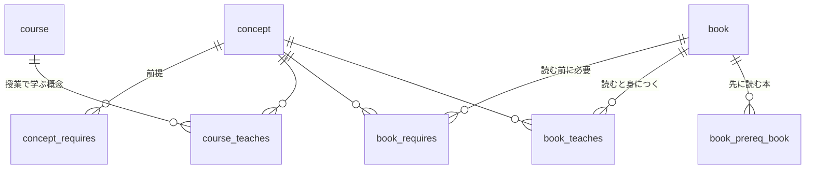

# レベル合わせるぞい

授業の履歴から、武蔵野大学6階の技術書で「いま読める本」を探すサイトです。

- 公開版は `index.html` 1枚だけで動きます(サーバー不要・外部APIなし)。
- 選んだ授業と分野は、見る人のブラウザの中(localStorage)だけに保存されます。

## GitHub Pages で公開する手順

1. GitHubで新しいリポジトリを作る(例: `level-awase`)。
2. このフォルダの中身をすべてそのリポジトリに入れて push する。
   ```
   git init
   git add .
   git commit -m "first commit"
   git branch -M main
   git remote add origin https://github.com/<ユーザー名>/level-awase.git
   git push -u origin main
   ```
3. GitHubのリポジトリで Settings → Pages を開く。
4. Build and deployment の Source を「Deploy from a branch」にし、Branch を `main` / `/ (root)` にして Save。
5. 1〜2分後に `https://<ユーザー名>.github.io/level-awase/` で開けます。

`.nojekyll` は、GitHub Pagesにそのまま配信してもらうための空ファイルです(消さないでください)。

## データの持ち方(データベース)

本・授業・概念のデータは、`src/library.db`(SQLite)に入っています。サイトは静的なので、公開版の `index.html` には、ここから作ったデータが埋め込まれます。



設計は `src/schema.sql` にあります。本を消すと、その本の前提・習得の記録も自動で一緒に消えます。

## 本を足す・消す・直す

`src` フォルダの中で実行します。

```
python3 manage.py list              # 本の一覧(番号つき)
python3 manage.py add               # 本を1冊足す(質問に答えるだけ)
python3 manage.py edit 12 author 山田太郎   # 項目を直す
python3 manage.py delete 12         # 本を消す(確認あり)
python3 manage.py concepts 回帰      # 概念の名前や id を探す
python3 manage.py build             # 検査して ../index.html を作り直す
```

そのあと、`git add .` → `git commit -m "本を更新"` → `git push` で公開版に反映されます。

表計算のように画面で直したいときは、無料の「DB Browser for SQLite」で `src/library.db` を開くと、表を見ながら編集できます(終わったら「変更を書き込み」を押してから、`python3 manage.py build`)。

テスト(任意):

```
node test_logic.js        # 判定とおすすめのテスト
python3 e2e.py            # ブラウザでの動作確認(Playwrightが必要)
```

`src/legacy_json/` は、データベースにする前のJSONです。もう使いません(記録として残しています)。

## 権利について

サイトに載せているのは、書名・著者・出版社・概念のタグ・要旨だけです。本やシラバスの本文は載せていません。
